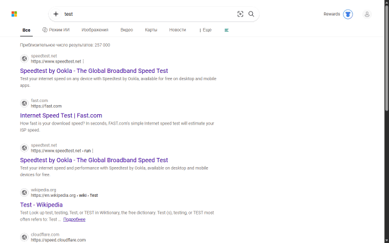

# Custom Search System Tabs (CSST)

> A Tampermonkey userscript for customizing the search tab bar in Google, Yandex, Bing, DuckDuckGo, Ecosia, Startpage, Brave Search, and Qwant.  
> Hide unwanted tabs, rename them, redirect them to other services, and add your own custom buttons — all right inside the search engine's navigation bar.
>
> **Author:** diple_df x claude · **Version:** 1.3.2

### Demo



Opening the panel with the ≡ button, hiding the "All" tab, and adding a custom button — on live Bing in Microsoft Edge.

---

## Installation

### Step 1 — Install a Userscript Manager

The script requires a browser extension to run. Supported managers:

| Extension | Chrome | Firefox | Edge |
|---|---|---|---|
| **Tampermonkey** (recommended) | ✓ | ✓ | ✓ |
| Violentmonkey | ✓ | ✓ | ✓ |
| Greasemonkey | — | ✓ | — |

Install the extension from your browser's official add-on store.

### Step 2 — Install the Script

**Option A — 1-click install (recommended):**

1. Click the automatic install link: **[Install Custom Search System Tabs](https://raw.githubusercontent.com/diple-df/CSST-tampermonkey-script/main/csst_tmprmnk.user.js)**
2. Tampermonkey will automatically intercept the file and open the installation prompt
3. Click **Install**

**Option B — manually:**

1. Copy the contents of `csst_tmprmnk.user.js`
2. Open Tampermonkey → **Create a new script**
3. Paste the code and press **Save** (`Ctrl+S`)

### Step 3 — Open Any Supported Search Engine

Go to any supported search engine and type a query — a settings button (≡) will appear in the tab bar.

---

## Supported Search Engines

| Search Engine | Domains | Accent Color | Button + panel |
|---|---|---|---|
| **Google** | `google.com`, `google.co.uk`, `google.ru` and all other regional domains | Blue `#4285f4` | ✓ verified live |
| **Yandex** | `yandex.ru`, `yandex.com`, `yandex.by`, `yandex.kz`, `yandex.com.tr`, `ya.ru` | Red `#fc3f1d` | ✓ verified live |
| **Bing** | `bing.com` | Teal `#008373` | ✓ verified live |
| **DuckDuckGo** | `duckduckgo.com` | Orange `#de5833` | ✓ verified live |
| **Ecosia** | `ecosia.org` | Green `#007a33` | ✓ selectors checked against real markup |
| **Brave Search** | `search.brave.com` | Orange-red `#fb542b` | ✓ checked against live HTML |
| **Qwant** | `qwant.com` | Purple `#4a4af4` | ✓ verified live |
| **Startpage** | `startpage.com` | Blue-teal `#0d7ea8` | button + panel ✓; hiding/renaming sections — no |

The button's size and alignment adapt to each engine's tab bar: it is smaller on Bing's short scopebar, rounder and larger on Google and Yandex, and so on.

### Startpage caveat

The current Startpage layout renders its search sections as buttons inside POST forms, not as links. The script finds the section strip and shows the ≡ button with a fully working settings panel, but **cannot hide, rename, or redirect the sections themselves** — they are not links. Custom buttons, presets, import/export, and every other setting still work.

> Ecosia, Brave, and Startpage serve a "are you a robot" wall from some networks. If the button does not appear, open the Tampermonkey menu → **Diagnostics**: it shows which engine was detected, which container was found, and how many tabs were recognised.

Settings are stored **separately per search engine** — changes in Google do not affect Yandex.

---

## Features

### The ≡ button

A single ≡ button appears in the search engine's tab bar. Clicking it opens the settings panel and nothing else: no floating tray on hover, no counter on the icon. Everything lives in the panel.

### Hide a Tab

Any standard search tab can be completely removed from the navigation bar. The script hides both the link itself and its wrapper element (`<li>`, `<div>`) so no empty gaps are left behind.

Tabs hidden by the search engine itself are never touched — only tabs that the script itself has hidden will be revealed when you unhide them.

### Rename a Tab

You can set any label for any tab. The change is applied instantly in the tab bar without a page reload. Clearing the label field restores the search engine's original text.

### Redirect a Tab to Another Service

Instead of opening the engine's own section, a tab can take you to any other website. For example:

- **Videos** tab on DuckDuckGo → opens **YouTube** with the same query
- **Images** tab on Yandex → opens **Google Images**
- **Maps** tab on Google → opens **OpenStreetMap**

Use `{query}` in the redirect URL — the script will automatically insert the current search query. If `{query}` is missing, the field is highlighted with an explanation.

### Add Custom Buttons

Beyond the standard tabs, you can add any number of your own buttons directly to the search engine's navigation bar. Custom buttons support `{query}` and are styled to match the native tabs.

Usage examples:
- Button "GitHub" → `https://github.com/search?q={query}`
- Button "Amazon" → `https://www.amazon.com/s?k={query}`
- Button "Translate" → `https://translate.google.com/?text={query}&sl=auto&tl=en`

---

## The Settings Panel

The panel opens from the ≡ button (or the Tampermonkey menu) and contains:

- a **filter** by tab name with a clear button, match counter, and a clear empty state;
- the **engine tabs list** with grouped section headers;
- **status chips** on each row: `hidden`, `name`, `redirect` — you can see what changed without expanding the row;
- **row expansion** (chevron) with Label, Preset service, and Redirect URL fields;
- **your own buttons** in a separate section, deletable in one click;
- **safe mode** and **interface language** at the bottom of the list;
- **export/import** of settings as JSON and a two-step **reset**.

### Reordering tabs

You can reorder tabs in the panel by dragging them (via the grip handle on the left) or with `Alt`+`↑`/`↓`. The order is saved and applied to the engine's tab bar. Until you actually move something, the engine's native order is preserved.

### Safe mode

If the search engine changed its markup and the script got in the way, enable **Safe mode (button only)**. The script then stops touching tabs entirely (no hiding, renaming, redirecting, or reordering), but the ≡ button and the panel keep working.

### Interface language

The language is detected automatically from the page's `lang` attribute, but you can pin it manually in the panel — the choice persists and no longer jumps on multilingual pages. For Arabic the panel switches to right-to-left (`dir="rtl"`): paddings, alignment, and panel anchoring are mirrored.

---

## How to Use

1. Open any supported search engine and type a query
2. Look for the **≡** button in the navigation tab bar — it's injected by the script
3. Click it — the settings panel opens next to the button
4. In the **Search engine tabs** section, configure each tab:
   - Click the eye icon to hide or show a tab
   - Expand the row with the chevron and edit the **Label**
   - Pick a preset service from the dropdown, or enter a **Redirect URL** manually
5. In the **My buttons** section, click **Add button** to insert your own link
6. Changes are applied instantly; the panel closes on `Esc`, an outside click, or the close button
7. The **Reset** button requires a second click to confirm and restores the defaults

> If the **≡** button does not appear in the tab bar, open the settings via the Tampermonkey extension menu → script → **Customize search tabs**.

### When tabs are not found

After a markup change the list may come up empty. In that case the panel shows a **"Show all known tabs"** button instead of bare text — settings stay reachable even if auto-detection broke.

The script also checks page shape, not just the hostname: if the tab container cannot be found several times in a row, it quietly does not interfere instead of dropping a button in a random place.

---

## The {query} Placeholder

Any URL in redirect fields or custom buttons can contain `{query}` — the script will replace it with the current search query, URL-encoded.

**Examples:**

```
https://www.youtube.com/results?search_query={query}
https://github.com/search?q={query}&type=repositories
https://www.amazon.com/s?k={query}
https://translate.google.com/?text={query}&sl=auto&tl=en
```

For a query like `funny cats`, the URL `https://www.youtube.com/results?search_query={query}` becomes `https://www.youtube.com/results?search_query=funny%20cats`.

---

## Supported UI Languages

| Code | Language |
|---|---|
| `en` | English |
| `ru` | Russian |
| `uk` | Ukrainian |
| `de` | German |
| `fr` | French |
| `es` | Spanish |
| `pt` | Portuguese |
| `tr` | Turkish |
| `it` | Italian |
| `pl` | Polish |
| `zh` | Chinese |
| `ja` | Japanese |
| `ko` | Korean |
| `hi` | Hindi |
| `ar` | Arabic (right-to-left) |

---

## Privacy

Only the following is written to storage (`GM_setValue`):

- labels of tabs and custom buttons;
- redirect and custom-button URLs (the template with `{query}`);
- flags: per-tab `hidden`, `safeMode`;
- tab order;
- the chosen interface language and the config schema version.

**Search queries are never stored.** `{query}` is substituted at click/apply time and lives only in the DOM. The script makes no requests to third-party services except one update check (see below).

### Import and export

Export is plain JSON you can copy or download as a file. Import works through a **file picker**: the script reads the chosen file and **validates it against a schema** — the schema version and field types are checked. Broken or foreign JSON is rejected with a clear message and never reaches your settings.

### Update check

Besides Tampermonkey's passive update mechanism (`@updateURL`/`@downloadURL`), the script checks its current version once a day: while idle (`requestIdleCallback`) it downloads its own raw file from `raw.githubusercontent.com` and compares version numbers. The request happens at most once per day, times out after 15 seconds, and any error fails silently. If a newer version exists, a banner with a link to the file is shown once per version.

You can run the check manually: Tampermonkey menu → **Check for updates**.

---

## Technical Details

### Granted Permissions

| Permission | Purpose |
|---|---|
| `GM_getValue` | Reading saved settings |
| `GM_setValue` | Saving settings |
| `GM_addStyle` | Injecting tab-bar button styles |
| `GM_registerMenuCommand` | Fallback entry point via the Tampermonkey menu |
| `GM_xmlhttpRequest` | Update check (only `raw.githubusercontent.com`) |
| `@connect raw.githubusercontent.com`, `@connect github.com` | Allowing the update check |

### How it works

- Engine adapters are described as **data**: container selectors, wrapper, link class, and a declarative link-classification map. Functions remain only where real logic is needed.
- The tab container is resolved through a cascade: engine selectors → stable anchor → semantic `nav` → "densest link cluster" → generic tab-strip heuristic. Every candidate is validated: it must sit near the top of the page, must not be a search-bar autocomplete, and must contain at least two same-origin links. A stale selector therefore never throws and never parks the button in a random `<ul>`; the cascade simply moves on. The winning strategy is remembered for the session and cached per pass.
- Changes are tracked by a single debounced `MutationObserver` (no `setInterval`) with re-entrancy protection and a quiet window after the script's own DOM writes. If the page re-renders the tab bar and removes the button together with its wrapper, the script puts it back on its own.
- A tab is not necessarily a link: on Startpage it is a `<button>` inside a form, so both link tabs and button tabs are supported.
- `window.__csstDiag` is available for debugging in the console: `{ engine, strategy, selector, container, tabs }` shows which cascade strategy won and which node the button was injected into. It stores nothing and sends nothing.
- The panel lives in a Shadow DOM (`<csst-ui id="usc-ui-host">`), which protects it from page scripts that remove injected light-DOM elements.
- All icons are inline SVG using `stroke="currentColor"` — no external resources, no web fonts.

### Script versions

| File | Script Name | Version | Status |
|---|---|---|---|
| `csst_tmprmnk.user.js` | Custom Search System Tabs | 1.3.2 | Current |

---
